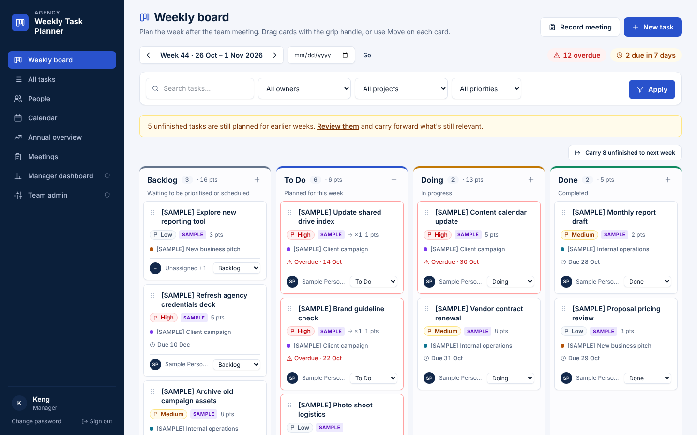
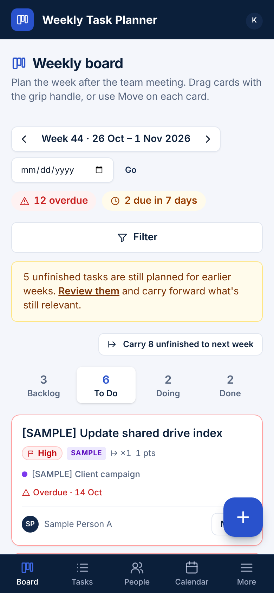

# Agency Weekly Task Planner

A private, responsive web app for planning and following up the team's work after weekly meetings: weekly Kanban board, everyone's tasks, monthly calendar, annual overview, meeting summaries drafted by Claude, and a Manager dashboard. On phones it behaves like an app — bottom tabs, one board column at a time, a floating **+** button and bottom-sheet menus.

**The Manager edits, the team views.** Team members sign in with their employee ID and their own password to see the whole picture; only the Manager changes tasks. This is enforced by the database, not just by hidden buttons.

**Stack:** Next.js 15 · React 19 · TypeScript · Tailwind CSS 4 · Supabase (Postgres, Auth, Realtime) · Claude API (optional) · Netlify or Vercel

| Desktop | Phone |
|---|---|
|  |  |

> Screenshots use placeholder people and `[SAMPLE]` tasks. The real database starts empty.

## ภาษาไทยโดยย่อ

- **ใช้ฟรีได้:** Supabase Free + Netlify Free (ดูขั้นตอนใน [docs/02](docs/02-setup-deployment.md))
- **Manager แก้ไขคนเดียว** ทีมล็อกอินด้วยรหัสพนักงาน + รหัสผ่านของตัวเอง เพื่อดูงานของทีมและงานเพื่อน
- **บันทึกประชุม:** วางข้อความ หรืออัปโหลด Word / รูป screenshot แล้วให้ Claude สรุป สร้างงานใหม่ และอัปเดตความคืบหน้าของงานเดิม ต้องใส่ `ANTHROPIC_API_KEY` (จ่ายตามการใช้ ประมาณไม่กี่บาทต่อการประชุมหนึ่งครั้ง)
- **รายชื่อทีมไม่อยู่ใน GitHub** เพราะ repo นี้เป็น public ไฟล์ `supabase/roster.local.sql` ส่งให้แยกต่างหาก

## Documentation

| | |
|---|---|
| [1. Product overview, architecture & data model](docs/01-overview-architecture.md) | Features, roles, stack, costs (free and paid), security model, tables, report definitions |
| [2. Setup, deployment & onboarding](docs/02-setup-deployment.md) | Supabase + Netlify step by step, email (SMTP), Claude API key, first Manager account, inviting the team, backups |
| [3. Manager configuration checklist](docs/03-manager-configuration.md) | Roster, secure employee-ID set-up, settings to decide |
| [4. Test checklist](docs/04-test-checklist.md) | Login, permissions, task updates, meeting summaries, filters, dashboard maths, phone layout |

## Quick start (development)

```bash
npm install
cp .env.example .env.local      # Supabase URL + keys, site URL, throttle secret, optional ANTHROPIC_API_KEY
npm run dev
```

In the Supabase SQL editor run `supabase/migrations/0001_schema.sql`, then `supabase/seed.sql`, then your private `supabase/roster.local.sql` (format: `supabase/roster.example.sql`). Create the Manager's login with `npm run bootstrap:manager`.

## Project layout

```
src/
  middleware.ts            session refresh, sign-in gate, CSP nonce
  app/
    login/ forgot-password/ set-password/ auth/   sign-in, reset, invitation flow
    (app)/board            weekly Kanban (segmented columns on phones)
    (app)/tasks            list + filters, task page, create
    (app)/people           individual view
    (app)/calendar         monthly calendar
    (app)/year             annual overview
    (app)/meetings         meetings; new = paste/upload notes → Claude draft → review → save
    (app)/dashboard        Manager dashboard
    (app)/admin            Team admin, projects
    api/export             CSV / JSON export (Manager)
  components/              board, forms, charts, filters, action sheet, FAB, meeting summarizer
  lib/                     auth guard, data access, validation, throttling, dates, filters, stats,
                           ai.ts (Claude API call, server only), ai-draft.ts (prompt + answer cleaning)
supabase/
  migrations/0001_schema.sql   tables, triggers, row-level security (Manager writes, team reads)
  seed.sql                     Manager + "General" project (no demo data)
  roster.example.sql           format for the private team list
  templates/                   invitation & reset emails
  tests/                       RLS / trigger tests (plain PostgreSQL)
scripts/bootstrap-manager.ts   one-time Manager account set-up
```

## Tests

```bash
npm test             # dates, filters, dashboard figures, meeting-summary parsing (17 tests)
npm run typecheck
# database security tests — see docs/02-setup-deployment.md §G
```
